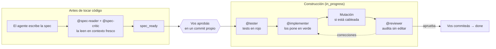

# sdd-agent-template

[](https://github.com/leandroeaguilar/sdd-agent-template/actions/workflows/verify.yml)
[](LICENSE)
[](AGENTS.md)

Plantilla de repositorio para hacer **desarrollo guiado por specs** (*spec-driven development*, SDD) con agentes de IA. El agente escribe qué va a construir, vos lo aprobás, y recién ahí se escribe código. **La aprobación no depende de que el agente se acuerde de pedirla: sin ella, el commit se rechaza.**

Sirve para arrancar un proyecto en el que trabajen Claude Code, Codex, Gemini CLI, Antigravity o Cursor. Trae el flujo de specs, controles deterministas de seguridad y memoria entre sesiones. El lenguaje, el framework y el código los ponés vos.

- **No es un framework ni una dependencia.** Son archivos que copiás una vez y pasan a ser tuyos.
- **Los controles son scripts, no consejos.** Devuelven un código de salida que frena el commit; no son instrucciones que el agente puede olvidar.
- **Todo está en español**, incluidos los mensajes de los hooks.

---

## Probalo en un minuto

Creá tu repo con **Use this template** en GitHub (o copiá la carpeta), clonalo y activá los controles locales:

```bash
git clone https://github.com/<vos>/<tu-proyecto>.git
cd <tu-proyecto>
bash setup.sh
```

> [!IMPORTANT]
> `bash setup.sh` se corre **una vez en cada clon**. Activa el gate de `git commit` con `core.hooksPath`, que es configuración local y no viaja con `git clone`. Sin ese paso no corre ningún control local.

Después comprobá que las guardas están encendidas, antes de escribir una línea de tu proyecto:

```bash
# 1. El gate SDD contra casos armados en repos git reales y temporales
bash .claude/hooks/sdd-gate.test.sh
# → termina con «0 fallaron»

# 2. security-guard frena la lectura de .env por shell, ANTES de ejecutarla
echo '{"tool_name":"Bash","tool_input":{"command":"cat .env"}}' \
  | bash .claude/hooks/security-guard.sh; echo "exit=$?"
# → exit=2 (bloqueado)

# 3. secret-scan rechaza un secreto en lo que estás por commitear
printf 'AWS_SECRET_ACCESS_KEY=%s%s\n' AKIA 0000000000000000 > fuga.txt
git add -f fuga.txt && bash .claude/hooks/secret-scan.sh; echo "exit=$?"
# → exit=1, señalando fuga.txt
git reset -q fuga.txt && rm fuga.txt
```

Corrélos en tu terminal, no a través del agente: dentro de Claude Code, el propio `security-guard` bloquea el comando 2 por mencionar `.env`, que es justamente lo que prueba. Ninguno de los tres commitea nada.

### Requisitos

| Herramienta | ¿Obligatoria? | Si falta |
|---|---|---|
| `git` ≥ 2.9 | sí | el gate de `git commit` no se activa |
| `bash` | sí — en Windows, Git Bash | los hooks y `setup.sh` no corren |
| `python` o `python3` | en la práctica, sí | `sdd-gate` y `security-guard` dejan pasar en vez de bloquear (*fail-open*). En Windows, `python3` puede ser el alias de Microsoft Store: los hooks prueban `python` primero |
| `gh` (GitHub CLI) | no | el aviso de PRs pendientes al abrir sesión no aparece |
| Claude Code | no | los hooks de sesión de `.claude/` quedan inertes; **el gate de `git commit`, CI y `AGENTS.md` siguen funcionando con cualquier agente** |

---

## Qué resuelve

| Lo que pasa cuando un agente trabaja suelto en tu repo | Cómo lo frena esta plantilla |
|---|---|
| Empieza a programar algo que no le aprobaste | La spec va primero, y `sdd-gate` rechaza cualquier commit de código hasta que la apruebes en un commit propio |
| Construye de más, o algo distinto de lo que pediste | Requisitos numerados (`R1..Rn`), una sección de *fuera de alcance* y un `@reviewer` que rechaza lo que nadie pidió |
| Escribe una spec que solo se entiende con la conversación en la cabeza | `@spec-reader` y `@spec-critic` la leen en contexto fresco antes de que te llegue para aprobar |
| Escribe el código y sus tests, y valida sus propios malentendidos | `@tester` escribe los tests desde la spec, `@implementer` construye sin poder tocarlos y `@reviewer` audita sin editar |
| Deja tests en verde que no detectarían un bug | Mutation testing al cierre, si tu stack lo tiene: cada mutante que sobrevive se mata con un test o se justifica |
| Dice «listo» sin haber probado nada | Cada tarea exige evidencia de qué se corrió, y el cierre exige probar el camino real |
| Corre un comando peligroso: lee `.env`, saca datos con `curl`, hace `git push --force` | En Claude Code, reglas `deny` y `security-guard`, que inspecciona cada comando **antes** de ejecutarlo |
| Commitea un secreto | `secret-scan` bloquea el commit local y vuelve a correr en CI, en cada PR y en cada push a `main` |
| Cada sesión arranca de cero y hay que volver a explicarle todo | En Claude Code, el agente no puede cerrar una sesión con archivos editados sin dejar su handoff en `docs/BITACORA.md` |
| Las reglas viven en un archivo que solo lee una herramienta | [`AGENTS.md`](AGENTS.md), el estándar abierto que leen todos los agentes |
| Entra una segunda persona y nadie sabe quién toca qué | `REPO_MODE=equipo`: gate de rama, acuerdo escrito en `COMO-TRABAJAMOS.md` y avisos de PR |

---

## Cómo funciona el flujo SDD

Cada feature tiene un estado en [`feature_list.json`](feature_list.json) y una carpeta en `specs/<feature>/` con tres documentos: `spec.md` (qué y por qué), `plan.md` (cómo) y `tasks.md` (los pasos, con su evidencia).



1. **El agente escribe la spec.** Resuelve y justifica las decisiones técnicas; las de producto te las pregunta.
2. **Dos subagentes la leen sin haber visto la conversación.** `@spec-reader` la parafrasea, y lo que tuvo que suponer es lo que estaba ambiguo. `@spec-critic` la ataca: requisitos que no se pueden testear, bordes que faltan, contradicciones. El agente corrige y recién ahí la deja en `spec_ready`.
3. **Vos la leés y la aprobás** pasando el estado a `in_progress`, en un commit que no trae código:
   ```bash
   git commit feature_list.json -m "aprueba: 001-mi-feature"
   ```
   Si la aprobación entra junto con el código, el commit se aprueba a sí mismo: `sdd-gate` lo frena y te muestra este comando.
4. **`@tester` escribe los tests primero**, desde la spec y sin saber cómo se va a implementar: uno por requisito y una propiedad por invariante, todos en rojo.
5. **`@implementer` construye** tarea por tarea hasta ponerlos en verde, sin poder tocarlos.
6. **Mutación**, si tu stack la tiene cableada: se rompe el código de a un cambio para comprobar que algún test se entera.
7. **`@reviewer` audita** el cambio contra la spec y aprueba o devuelve correcciones concretas.
8. **Vos commiteás y cerrás** la feature (`done`).

Lo que sostiene ese flujo, en corto:

- **La pausa es un gate, no un pedido.** Con una feature en `spec_ready`, cualquier commit que toque código se rechaza.
- **Quien escribe el código no escribe los tests de los requisitos, ni los puede aflojar.** El `@tester` registra el hash de cada archivo de test y el `@reviewer` los recalcula: un test editado, borrado o salteado después es un rechazo.
- **Que la suite esté en verde no alcanza.** El `@reviewer` lee el test de cada requisito y se pregunta si fallaría con el requisito roto. La verificación de cierre corre contra el camino real; lo que solo se probó contra un sustituto queda como *diferido*, no como verificado.
- **Las features grandes se parten en fases**, con un `@implementer` por fase y en paralelo si no comparten archivos. La aprobación sigue siendo una sola.
- **No todo necesita spec.** Una feature con `"sdd": false` no pasa por la puerta: sirve para un arreglo chico. Vale la pena pasar siempre por spec lo que sale caro si sale mal: dinero, permisos, datos de usuarios.

Las reglas completas, que son las que leen los agentes, están en [`AGENTS.md`](AGENTS.md). Fuzzing, tests de contrato entre fases y evals de los subagentes son opcionales y se activan por feature: [`docs/testing-opcional.md`](docs/testing-opcional.md).

---

## Empezar tu proyecto

La plantilla gobierna la ejecución; no piensa el producto. Conviene tener claro qué vas a construir antes de arrancar.

1. **Escribir el producto** en `docs/product/PRD.md`: qué construís, para quién y cómo sabés que funcionó.
2. **Completar [`AGENTS.md`](AGENTS.md)** con el nombre del proyecto, el stack y los comandos reales. Borrá los placeholders que no apliquen.
3. **Cablear lint y tests** en tres lugares, con los mismos comandos:
   - el final de `.githooks/pre-commit`;
   - el paso *Lint y tests* de `.github/workflows/verify.yml`;
   - la línea **Suite completa (cierre)** de `AGENTS.md`, de donde la leen los agentes.

   Si tu stack las tiene, declará también en `AGENTS.md` la librería de *property-based testing* y el comando de mutación. Son opcionales: sin ellas el flujo sigue y el `@reviewer` las lista como *diferido*.
4. **Registrar la primera feature** en [`feature_list.json`](feature_list.json): poné el nombre real del proyecto y reemplazá `000-ejemplo` por tu primera feature, en estado `"pending"`.
5. **Reemplazar este README** por el de tu proyecto: completá [`README.proyecto.md`](README.proyecto.md) y renombralo a `README.md`.
6. **Pedirle la spec al agente**, abierto en la carpeta del repo. Te entrevista si hay dudas de producto, escribe `specs/001-<nombre>/`, la hace revisar y frena a esperar tu aprobación.

> [!TIP]
> **¿Querés la seguridad y la bitácora, pero no el flujo de specs?** Borrá `feature_list.json`: el gate SDD queda inerte y todos los demás controles siguen funcionando.

Tus permisos personales o carpetas adicionales van en `.claude/settings.local.json`, que está gitignoreado.

<details>
<summary><strong>Qué trae el repo</strong></summary>

```text
tu-proyecto/
├── specs/000-ejemplo/        plantilla de la trinidad: spec.md (qué) → plan.md (cómo) → tasks.md (pasos + evidencia)
├── docs/
│   ├── product/              PRD y decisiones de producto (el agente no lo edita por su cuenta)
│   ├── adr/                  decisiones técnicas caras de revertir
│   ├── testing-opcional.md   fuzzing, contratos entre fases, evals y herramientas de terceros
│   └── BITACORA.md           handoff entre sesiones de agente
├── .claude/
│   ├── agents/               @spec-reader, @spec-critic, @tester, @implementer y @reviewer
│   ├── hooks/                sdd-gate (con su banco de tests), security-guard, secret-scan, bitácora, avisos
│   ├── evals/                casos con trampa sembrada para probar el prompt del @reviewer
│   └── settings.json         reglas deny y hooks de sesión de Claude Code
├── .githooks/pre-commit      el gate de git commit: rama → flujo SDD → secretos → tu lint y tus tests
├── .github/
│   ├── workflows/            verify.yml (controles en cada PR) y aviso-de-pr.yml
│   └── CODEOWNERS.example    mapa opcional de revisores por zona
├── AGENTS.md                 las reglas que leen todos los agentes
├── CLAUDE.md                 importa AGENTS.md y suma lo propio de Claude Code
├── feature_list.json         manifiesto de features y sus estados
├── repo.conf                 REPO_MODE=solo|equipo y rama principal
├── COMO-TRABAJAMOS.example.md acuerdo de equipo en lenguaje llano
├── README.proyecto.md        esqueleto del README de tu proyecto
└── setup.sh                  activa y verifica los controles en cada clon
```

</details>

<details>
<summary><strong>Qué corre y cuándo</strong></summary>

`CC` = solo dentro de Claude Code. `todos` = cualquier agente y cualquier persona. Cada kill-switch es un archivo vacío dentro de `.repo-meta/`, que está gitignoreado.

| Pieza | Se dispara con | Dónde | Kill-switch |
|---|---|---|---|
| `pr-notice.sh` | inicio de sesión | CC | `pr-notice.disabled` |
| `security-guard.sh` | antes de cada `Bash` o `Read` | CC | `security-guard.disabled` |
| `session-touch.sh` | después de cada `Edit` o `Write` | CC | — |
| `agent-diary.sh` | cierre de sesión | CC | `diary.disabled` |
| `check-diary-size.sh` | lo llama `agent-diary.sh` | CC | `diary-cap.disabled` |
| `search-sessions.py` | a mano, desde la terminal | todos | — |
| gate de rama (`REPO_MODE=equipo`) | `git commit` | todos | `branch-gate.disabled` |
| `sdd-gate.sh` | `git commit` y CI | todos | `sdd-gate.disabled` |
| `secret-scan.sh` | `git commit` y CI | todos | `secret-scan.disabled` |
| `verify.yml` (CI) | cada PR, cada push a `main`, o a mano | todos | desactivar el workflow |
| `aviso-de-pr.yml` | cada PR | todos | desactivar el workflow |

En `verify.yml`, **bloquean** el secret-scan, los tests del gate SDD y tu lint y tests una vez cableados. **Solo informan** el gate SDD, que revisa commit por commit lo que trae el PR o el push, y el chequeo de la bitácora.

</details>

---

## Más de una persona y agentes en paralelo

Con un solo dueño esta capa no hace nada: `REPO_MODE=solo` es el modo por defecto. Cuando entra la segunda persona:

1. **Pasar a `REPO_MODE=equipo`** en [`repo.conf`](repo.conf). Desde ese commit, el `pre-commit` rechaza todo commit directo sobre `main`: todo entra por PR.
2. **Completar [`COMO-TRABAJAMOS.example.md`](COMO-TRABAJAMOS.example.md)** y renombrarlo a `COMO-TRABAJAMOS.md`. Es lo que la persona nueva lee en diez minutos antes de su primer commit: prefijos de rama, zonas, secretos.
3. **Copiar `.github/CODEOWNERS.example` a `.github/CODEOWNERS`** con los usuarios reales, si aplica.
4. **Cada persona corre `bash setup.sh` en su clon.** El script aborta si el gate local no queda activo.
5. **Reglas de rama en GitHub** (*Settings → Rules*, sobre `main`): exigir PR, revisión de Code Owners, el check `verify` y bloquear force-push.

> [!WARNING]
> **El paso 5 no existe en GitHub Free con repositorio privado.** La API responde `403 · "Upgrade to GitHub Pro or make this repository public"`. En ese plan, `verify` corre en cada PR pero **es señal, no bloqueo**: un PR en rojo se puede mergear igual. El único control automático real es el gate de `git commit` en cada máquina, así que el paso 4 (verificable con `git config core.hooksPath`) y el acuerdo de `COMO-TRABAJAMOS.md` pasan a ser los controles que importan.

Para correr **varios agentes a la vez**, usá un worktree físico por agente:

```bash
git worktree add -b agent/<nombre> ../<proyecto>-<nombre>
```

Cada worktree tiene su propio checkout y su propio `.repo-meta/`. `docs/BITACORA.md` se mergea con `merge=union`, así que dos handoffs simultáneos no dan conflicto; por eso cada entrada lleva agente y rama en el encabezado. Las reglas completas están en [`AGENTS.md`](AGENTS.md).

---

## Límites

Lo que esta plantilla **no** garantiza, para que no lo des por hecho:

- **Los hooks de `.claude/` solo corren en Claude Code.** Con cualquier otro agente, el control automático es el gate de `git commit`. Que no lea credenciales ni saque datos con `curl` depende del criterio del agente y de tu entorno.
- **Todo control se puede saltear a propósito:** el gate con `git commit --no-verify`, y cada hook con su kill-switch. Es deliberado: saltearlo tiene que ser un acto explícito y visible, no imposible.
- **Una feature que nunca entra a `feature_list.json` no está protegida.** El gate reacciona a los estados; si nadie registra la feature, no hay puerta.
- **El manifiesto lo puede editar un agente.** `sdd-gate` garantiza que la aprobación quede aislada y fechada en su propio commit, no quién la tipeó.
- **Varios controles son instrucciones, no restricciones del sistema de archivos:** que el `@reviewer` no edite, y que nadie toque los tests del `@tester`. Los hashes de esos tests viven en un archivo que un agente también puede editar: frenan el descuido, no la mala fe.
- **Mutación y property-based testing dependen de tu stack.** Sin comando o librería declarados en `AGENTS.md` quedan como *diferido*: el flujo no se bloquea, pero tampoco los tenés.
- **Solo el prompt del `@reviewer` tiene casos de prueba** ([`.claude/evals/`](.claude/evals/README.md)), y se corren a mano. El resto de los agentes se prueba usándolos.
- **Hasta que cablees tus tests, `verify` da verde validando solo secretos y el gate SDD.** No corrió ninguna prueba de tu proyecto, y su resumen lo dice.

---

## Ideas en las que se apoya

El estándar [AGENTS.md](https://agents.md), el flujo `spec → plan → tasks` de [github/spec-kit](https://github.com/github/spec-kit), la notación EARS para requisitos, la revisión de specs en contexto fresco de [google/elephant-goldfish-model](https://github.com/google/elephant-goldfish-model) y el frontmatter [OKF v0.2](https://github.com/GoogleCloudPlatform/knowledge-catalog) para la documentación.

## Licencia

[MIT](LICENSE) © 2026 Leandro Aguilar.
